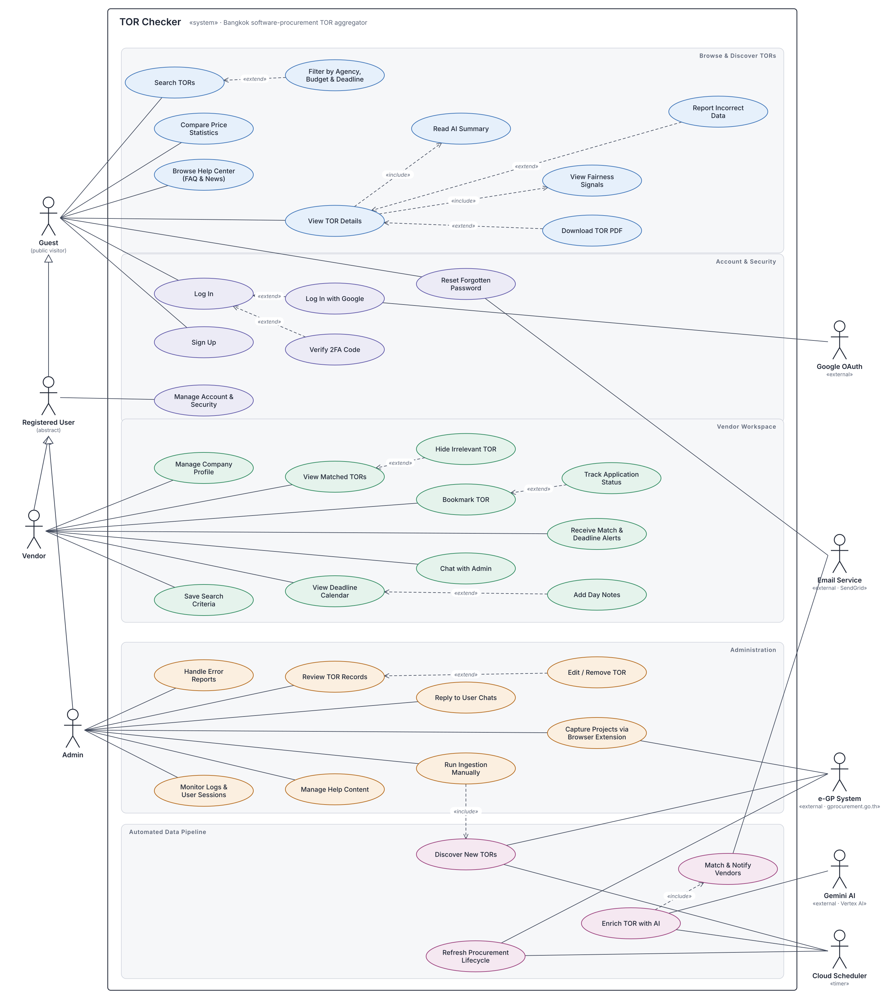

# Use Case Model

The TOR Checker use case diagram, drawn from the actual codebase (backend routes, frontend pages, the Chrome extension, and the Cloud Run jobs).

How these parts are deployed and connected is shown in the [system design](system-design.md).

[`use-case-diagram.svg`](use-case-diagram.svg) is the vector version and stays sharp at any zoom level.

## Notation

| Symbol | Meaning |
|---|---|
| Solid line | Association: the actor uses the use case |
| Solid line with hollow triangle | Generalization: the actor inherits another actor's use cases |
| Dashed arrow «include» | The use case at the arrowhead always runs as part of the base use case |
| Dashed arrow «extend» | The use case at the tail optionally adds behavior to the base use case under a condition |

## Actors

| Actor | Type | Role |
|---|---|---|
| Guest | Primary | Public visitor; can search and read TORs without signing in |
| Registered User | Abstract | Parent of every account holder; inherits everything a Guest can do |
| Vendor | Primary | Software company that tracks TORs and prepares bids |
| Admin | Primary | Maintains data and the system; must pass 2FA on every sign-in |
| Google OAuth | Secondary | Verifies identity for Sign in with Google |
| Email Service | Secondary | SendGrid; sends password-reset emails and TOR digest emails |
| e-GP System | Secondary | Thailand's government e-procurement system; the source of TOR data |
| Gemini AI | Secondary | Model on Vertex AI that reads and summarizes TOR documents |
| Cloud Scheduler | Secondary · timer | Triggers discovery, AI enrichment, and lifecycle refresh on a schedule |

## Use cases

### Browse & Discover TORs

| ID | Use case | Actor | Relationship | Description |
|---|---|---|---|---|
| UC-01 | Search TORs | Guest | — | Search TOR announcements by keyword |
| UC-02 | Filter by Agency, Budget & Deadline | — | «extend» UC-01 | Narrow results by agency, category, budget, and submission deadline, only when the user wants to |
| UC-03 | Compare Price Statistics | Guest | — | View budget and reference-price statistics by category |
| UC-04 | Browse Help Center | Guest | — | Read FAQs and announcements from the admin team |
| UC-05 | View TOR Details | Guest | — | Open the detail page of a single TOR |
| UC-06 | Read AI Summary | — | UC-05 «include» | Gemini-written summary of the TOR, shown every time the details are opened |
| UC-07 | View Fairness Signals | — | UC-05 «include» | Neutral review prompts, e.g. a brand name in the spec or an unusually short submission window; never accusations |
| UC-08 | Download TOR PDF | — | «extend» UC-05 | Download the original TOR document stored in Cloud Storage |
| UC-09 | Report Incorrect Data | — | «extend» UC-05 | Flag wrong TOR data for an admin to review (handled in UC-28) |

### Account & Security

| ID | Use case | Actor | Relationship | Description |
|---|---|---|---|---|
| UC-10 | Log In | Guest | — | Sign in with email and password |
| UC-11 | Log In with Google | Google OAuth | «extend» UC-10 | Sign in with a Google account instead of a password |
| UC-12 | Verify 2FA Code | — | «extend» UC-10 | Enter an authenticator-app code when 2FA is on; required for every admin sign-in |
| UC-13 | Sign Up | Guest | — | Register as a vendor |
| UC-14 | Reset Forgotten Password | Guest, Email Service | — | Request a password reset; the system emails a reset link |
| UC-15 | Manage Account & Security | Registered User | — | Change email or password, set up 2FA, view and revoke sessions, delete the account; each action requires re-authentication |

### Vendor Workspace

| ID | Use case | Actor | Relationship | Description |
|---|---|---|---|---|
| UC-16 | Manage Company Profile | Vendor | — | Enter company details, expertise, and technologies used for TOR matching |
| UC-17 | View Matched TORs | Vendor | — | See TORs that match the company profile |
| UC-18 | Hide Irrelevant TOR | — | «extend» UC-17 | Hide a TOR that is not relevant from the list |
| UC-19 | Bookmark TOR | Vendor | — | Save a TOR to follow |
| UC-20 | Track Application Status | — | «extend» UC-19 | Set the status: interested / preparing / submitted / missed |
| UC-21 | Save Search Criteria | Vendor | — | Save a search; the system notifies the vendor when a new TOR matches it |
| UC-22 | View Deadline Calendar | Vendor | — | See submission deadlines of followed TORs on a calendar |
| UC-23 | Add Day Notes | — | «extend» UC-22 | Write a note on a calendar day |
| UC-24 | Receive Match & Deadline Alerts | Vendor | — | Receive three kinds of notifications: profile match, saved-search match, and deadline reminder |
| UC-25 | Chat with Admin | Vendor | — | Send questions to the admin team |

### Administration

| ID | Use case | Actor | Relationship | Description |
|---|---|---|---|---|
| UC-26 | Review TOR Records | Admin | — | Check the quality of ingested TOR data |
| UC-27 | Edit / Remove TOR | — | «extend» UC-26 | Correct a TOR or remove a wrong one from the system |
| UC-28 | Handle Error Reports | Admin | — | Review and resolve incorrect-data reports from users |
| UC-29 | Reply to User Chats | Admin | — | Answer vendor messages |
| UC-30 | Manage Help Content | Admin | — | Create, edit, and delete FAQs and announcements |
| UC-31 | Monitor Logs & User Sessions | Admin | — | View system and audit logs; revoke a user's sessions |
| UC-32 | Run Ingestion Manually | Admin | UC-34 «include» | Start an ingestion run without waiting for the schedule |
| UC-33 | Capture Projects via Browser Extension | Admin, e-GP System | — | Collect project numbers from the e-GP search page with the Chrome extension and send them to the system, up to 100 per send |

### Automated Data Pipeline

| ID | Use case | Actor | Relationship | Description |
|---|---|---|---|---|
| UC-34 | Discover New TORs | Cloud Scheduler, e-GP System | — | Fetch new announcements, keep only Bangkok agencies and software procurement, and store the PDFs |
| UC-35 | Enrich TOR with AI | Cloud Scheduler, Gemini AI | — | Have Gemini read the PDF, write a summary, assign a category, and detect fairness signals |
| UC-36 | Match & Notify Vendors | Email Service | UC-35 «include» | Match new TORs against vendor profiles and saved searches, then send notifications and digest emails |
| UC-37 | Refresh Procurement Lifecycle | Cloud Scheduler, e-GP System | — | Update the procurement stage and deadlines of TORs that are still open |

## Modeling notes

- **Login is a precondition** for every Vendor and Admin use case, so the diagram does not draw an «include» to Log In from each one.
- **Registered User is an abstract actor.** Vendor and Admin inherit from Registered User, which inherits from Guest.
- **Cloud Scheduler is a timer actor** that triggers the `tor-discovery`, `tor-enrichment`, and `tor-lifecycle` jobs. An admin can also start an ingestion run through UC-32.
- The admin statistics dashboard and the Terms and Privacy Policy pages only display information, so they are not counted as use cases.
