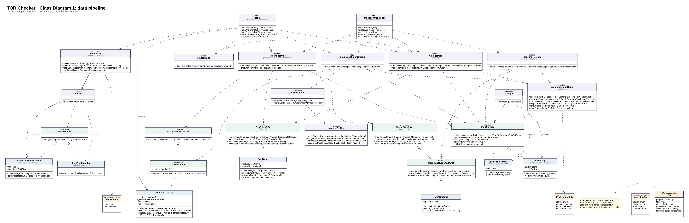
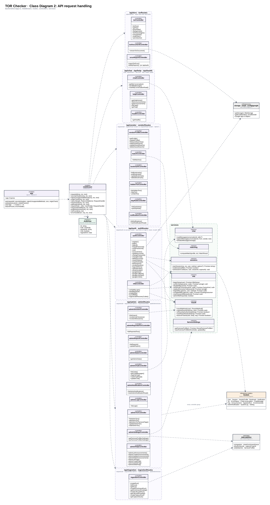

# Class Diagram

The structure of the TOR Checker backend code: its classes, interfaces and modules, what each one offers, and how they depend on each other. It is drawn from [`backend/src`](../../backend/src). The [domain model](domain-model.md) shows the problem's concepts, the [ER diagram](er-diagram.md) shows how data is stored, and this diagram shows how the code is built.

Which requirement and issue each use case traces to is in the [traceability table](README.md#traceability-to-requirements-and-issues).

There are two diagrams:

1. **Data pipeline:** the jobs that bring TORs in, and the classes and interfaces they work through: e-GP clients, the Gemini extractor, storage and e-mail.
2. **API request handling:** how a request passes through the app, the middleware, a controller and a service.

## How the code maps to UML

The backend is TypeScript written mostly as modules of exported functions, with classes where there is state or more than one implementation. The diagrams show both:

| In the code | In the diagram |
|---|---|
| A `class` | A class box: name, attributes, operations |
| An `interface` | A box marked «interface» with its name in italics |
| A file of exported functions (`runIngestion.ts`, `authController.ts`, …) | A box marked «module», «controller» or «service», with the exported functions as operations. UML draws such a utility module as a class whose operations are all static. |
| A Mongoose model | A box marked «Mongoose model»; the full fields are in the ER diagram |

| Symbol | Meaning |
|---|---|
| `+` / `-` | Public / private |
| Dashed line, hollow triangle | Realization: the class implements the interface |
| Solid line, hollow triangle | Generalization: the interface extends another |
| Dashed line, open arrow | Dependency: calls or uses. «create» means it constructs the target |
| Dashed rounded frame | A package: the controllers behind one route prefix, or the services |

## 1. Data pipeline

[`class-diagram-pipeline.svg`](class-diagram-pipeline.svg) is the vector version.

### Interfaces and their implementations

Every outside system is reached through an interface. The pipeline depends only on the interface; which class sits behind it is decided at start-up, so tests pass in fakes and development runs without Google Cloud.

| Interface | Implementations | Chosen by |
|---|---|---|
| `EgpClientLike`: search, project detail, announcements and files from the BMA e-GP portal | `EgpClient` | Always the real client; tests pass a fake through `deps.client` |
| `GprocClientLike`: project detail, announcements, hearing date and invitation PDF from the national e-GP | `GprocClient` (through `GprocCaptureClientLike`) | `GPROC_ENABLED` |
| `GprocCaptureClientLike` extends `GprocClientLike` with budget, document bundle and bundle download, for capture | `GprocClient` | |
| `BidDeadlineExtractor`: reads the bid deadline from an invitation PDF | `GeminiExtractor` (through `TorExtractor`) | |
| `TorExtractor` extends `BidDeadlineExtractor` with `extract()`: summary, criteria, classification and fairness signals from the TOR PDFs | `GeminiExtractor` | `selectExtractor()`, from `EXTRACTOR` (default `gemini`) |
| `BlobStorage`: put, stream, check, delete files | `GcsStorage`, `LocalDiskStorage` | `getStorage()`, from `STORAGE_DRIVER` |
| `EmailSender`: send one e-mail | `SendGridEmailSender`, `LogEmailSender` | `getEmailSender()`, from `EMAIL_DRIVER` |

`EgpClient` and `GprocClient` make every request through `safeFetch()` from `utils/outbound`, which only allows their configured hosts.

### Modules

| Module | Role |
|---|---|
| `jobs` | Entry points of the four Cloud Run jobs. Each connects to MongoDB, runs one pipeline step and exits. `runEnrichmentJob()` then refreshes the new TORs' procurement stage and calls `notifyMatches()`. |
| `ingestionController` | The same steps started by an admin from the API ([`/api/ingestion`](api.md#ingestion)) |
| `runIngestion` | Discovery: searches BMA e-GP, saves new or changed TORs and their PDFs, queues them for AI. Records an `IngestionRun`. |
| `drainEnrichmentQueue` | Takes jobs from the queue, sends each TOR to the `TorExtractor`, and applies the result through `applyExtractionToTor()` |
| `torExtractor` | `applyExtractionToTor()` writes the AI result to the `Tor`, filtering fairness signals through `fairnessPrefilter` |
| `fairnessPrefilter` | Drops signals below the admin's thresholds and computes the facts behind each one (budget deviation, bid window) |
| `enrichmentJobRepo` | The AI work queue on `EnrichmentJob`: enqueue, claim with a lease, renew, complete, fail with back-off |
| `refreshLifecycle` | Checks each open TOR's procurement stage on e-GP and reads bid deadlines from invitation PDFs |
| `captureProjects` | Turns project numbers from the Chrome extension into TORs, using national e-GP bundles |
| `stalledRuns` | Marks runs whose process died as failed and alerts the admins |
| `notifications` | Creates profile and saved-search match notifications, then e-mails the digests |
| `storage`, `email` | Factories that return the configured `BlobStorage` or `EmailSender` |

Every function takes its outside dependencies in an optional `deps` argument (`RunIngestionDeps`, `DrainDeps`, `RefreshLifecycleDeps`, `CaptureDeps`), defaulting to the real implementation. That is how the 1,300+ backend tests run the whole pipeline without the network.

## 2. API request handling

[`class-diagram-api.svg`](class-diagram-api.svg) is the vector version.

A request goes from left to right:

1. **`app`** (`app.ts`) runs the global middleware on every request: `requestId`, `securityHeaders`, `rejectUnsupportedMethods`, CORS, `originCheck`, then JSON and cookie parsing.
2. It hands the request to the router for its prefix. Each package in the diagram is one router and the controllers it uses. The router adds its own middleware, written under the package name: `requireAuth`, `requireRole(...)`, `requireAdminMfa`, `auditAdminAction`, and rate limits made by `rateLimit(opts)`.
3. `requireAuth` checks the session cookie and creates `req.user`, an **`AuthUser`** with the user's id, role, session id, whether the session passed two-step verification, and when it signed in.
4. A **controller** handler validates the input with Zod, checks ownership with `req.user.id`, and does the work. Every handler has the form `(req: Request, res: Response) => Promise<void>`, so the diagram lists names only. The [API reference](api.md) gives each handler's route.
5. Logic shared by more than one controller lives in a **service**: sign-in sessions, two-step verification, re-authentication, profile matching, chat, and the fairness thresholds.
6. Controllers and services read and write the **models**. Errors are thrown as `httpError(status, message)` and turned into JSON by `errorHandler`, the last middleware. `notFound` answers any path that no router matched.

| Package | Controllers | Services and other dependencies |
|---|---|---|
| `/api/auth` | `authController`, `mfaController` (and `errorReportController.listMyReports`) | `sessions`, `mfa`, `reauth`; storage for avatars; e-mail for password reset; Google sign-in |
| `/api/tors` | `torController`, `torDocumentController`, `errorReportController` | storage for PDFs |
| `/api/vendor` | `vendorProfileController`, `matchController`, `bookmarkController`, `hiddenTorController`, `dayNoteController`, `notificationController` | `matching` |
| `/api/chat`, `/api/help`, `/api/health` | `chatController`, `helpController`, `healthController` | `chat` |
| `/api/admin` | Ten admin controllers: TORs, reported TORs, reports, stats, settings, notifications, logs, sessions, chat, help | `chat`, `reauth`, `fairnessSettings`; `fairnessPrefilter` from the pipeline |
| `/api/ingestion` | `ingestionController` | The pipeline modules in diagram 1 |

## Design notes

- **Interfaces at every outside boundary.** e-GP, Gemini, file storage and e-mail all sit behind interfaces, so the logic doesn't depend on a vendor and can be tested without one.
- **Dependency injection by argument.** No framework: functions take a `deps` object, and the real implementation is the default.
- **Thin controllers, shared services.** Controllers handle HTTP (parse, validate, answer); anything two controllers share goes in a service.
- **Middleware for cross-cutting rules.** Authentication, roles, admin two-step verification, rate limits, CSRF and audit logging are middleware on the router, not checks repeated in each handler.
- **One `Error` type for HTTP failures.** `httpError()` carries the status; the error handler is the only place that writes error responses, so unexpected errors never leak details.
