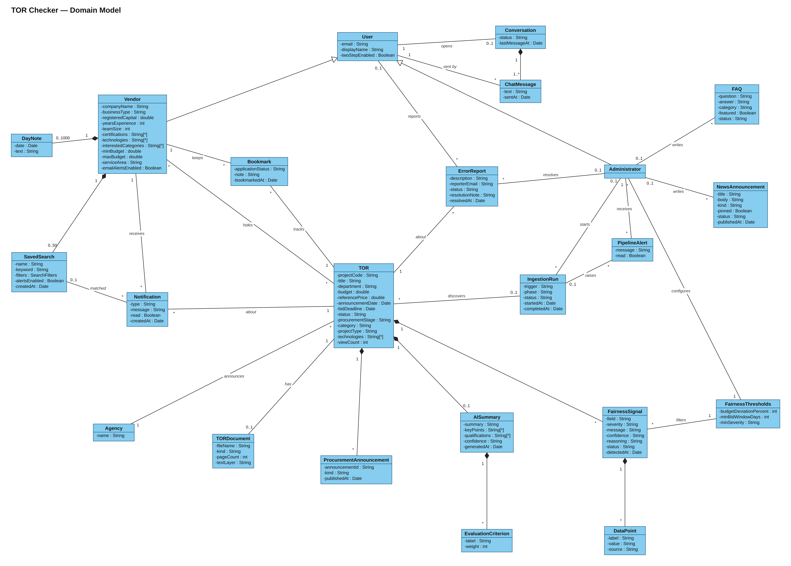

# Domain Model

The concepts of the TOR Checker problem domain, their attributes, and how they relate. It describes **what the system is about**, not how it is stored: the database structure belongs in an ER diagram and the code structure in a class diagram. The concepts come from the actual codebase (the Mongoose models in [`backend/src/models`](../../backend/src/models) and the features built on them), named the way users and the [use case model](README.md) talk about them.

Which requirement and issue each use case traces to is in the [traceability table](README.md#traceability-to-requirements-and-issues).

[`domain-model.svg`](domain-model.svg) is the vector version and stays sharp at any zoom level.

## Notation

| Symbol | Meaning |
|---|---|
| Box | A concept: its name, then its attributes as `-name : Type` |
| Solid line | Association; the italic label names it |
| Line with a filled diamond ◆ | Composition: the part belongs to the whole at the diamond and is removed with it |
| Line with a hollow triangle △ | Generalization: Vendor and Administrator are kinds of User |
| `1`, `0..1`, `*`, `1..*`, `0..50` | Multiplicity: how many of the concept at that end take part |
| `String[*]` | A list of values |

## Concepts

### People

| Concept | What it is |
|---|---|
| User | Anyone with an account. A visitor without an account can still search and read TORs, so Guest is an actor in the use case model, not a concept here. |
| Vendor | A software company that follows TORs and prepares bids. Its attributes are the business profile used to match TORs. |
| Administrator | A member of the team that maintains the data and the system. Admin access needs two-step verification (on by default). |

### TORs and what the AI adds

| Concept | What it is |
|---|---|
| Agency | A Bangkok Metropolitan Administration body that announces procurement, e.g. สำนักการแพทย์. |
| TOR | One software procurement project and its Terms of Reference. `status` is open, closing soon or closed; `procurementStage` is draft, inviting, awarded or cancelled. |
| TORDocument | The TOR or invitation PDF fetched from e-GP. `textLayer` says whether it is digital, scanned, unreadable or missing. |
| ProcurementAnnouncement | One announcement e-GP published for the project: draft TOR, reference price, invitation, winner, cancellation and so on. |
| AISummary | The Gemini-written summary, key points and qualifications. `confidence` is high, medium or low. |
| EvaluationCriterion | One bid evaluation criterion from the summary and its weight in percent. |
| FairnessSignal | A neutral review prompt about the TOR, never an accusation. `field` is budget, deadline, qualification requirements or other; `severity` and `confidence` are high, medium or low; `reasoning` and the signal's data points are shown to administrators only. |
| DataPoint | One fact behind a fairness signal, e.g. the budget or the reference price. `source` says whether the system or the AI supplied it. |
| FairnessThresholds | The administrator's cut-offs for publishing a fairness signal: the budget deviation from the reference price, the minimum bid window, and the minimum severity. |

### Vendor workspace

| Concept | What it is |
|---|---|
| Bookmark | A TOR the vendor follows. `applicationStatus` is interested, preparing, submitted or missed. |
| SavedSearch | A keyword and filters kept for reuse, with alerts on or off. |
| Notification | An in-app alert about one TOR: a profile match or a saved-search match. A deadline reminder is allowed by the data model, but nothing creates one yet. |
| DayNote | A vendor's note on one day of the deadline calendar. |

### Support and operations

| Concept | What it is |
|---|---|
| ErrorReport | A report that a TOR's data is wrong, open until an administrator resolves it. |
| Conversation | The chat thread between one user and the admin team. |
| ChatMessage | One message in a conversation, from the user or an administrator. |
| FAQ | A help-center question and answer. |
| NewsAnnouncement | News, an update or a maintenance notice in the help center. |
| IngestionRun | One run that discovers, enriches, refreshes or captures TORs from e-GP, started on a schedule or by an administrator. |
| PipelineAlert | A notice to an administrator that an ingestion run failed or stalled. |

## Associations

| Association | Multiplicity | Meaning |
|---|---|---|
| User *opens* Conversation | 1 to 0..1 | Each user has at most one chat thread with the team |
| Conversation ◆ ChatMessage | 1 to 1..* | A thread starts with its first message |
| ChatMessage *sent by* User | * to 1 | |
| User *reports* ErrorReport | 0..1 to * | A visitor can report without an account |
| Administrator *resolves* ErrorReport | 0..1 to * | Unresolved reports have no resolver |
| ErrorReport *about* TOR | * to 1 | |
| Vendor *keeps* Bookmark, Bookmark *tracks* TOR | 1 to *, * to 1 | A vendor follows the same TOR at most once |
| Vendor *hides* TOR | * to * | Hidden TORs leave the vendor's search results and matches |
| Vendor ◆ SavedSearch | 1 to 0..50 | At most 50 saved searches |
| Vendor ◆ DayNote | 1 to 0..1000 | At most one note per day, 1,000 in all |
| Vendor *receives* Notification | 1 to * | |
| Notification *about* TOR | * to 1 | |
| Notification *matched* SavedSearch | * to 0..1 | Only saved-search matches have one |
| Agency *announces* TOR | 1 to * | |
| TOR *has* TORDocument | 1 to 0..1 | Until the PDF is fetched there is none |
| TOR ◆ ProcurementAnnouncement | 1 to * | |
| TOR ◆ AISummary | 1 to 0..1 | Only TORs the AI has processed have one |
| AISummary ◆ EvaluationCriterion | 1 to * | |
| TOR ◆ FairnessSignal | 1 to * | Most TORs have none |
| FairnessSignal ◆ DataPoint | 1 to * | |
| FairnessThresholds *filters* FairnessSignal | 1 to * | Signals below the thresholds are not published |
| Administrator *configures* FairnessThresholds | * to 1 | One set of thresholds for the whole system |
| Administrator *starts* IngestionRun | 0..1 to * | Scheduled runs have no administrator |
| IngestionRun *discovers* TOR | 0..1 to * | |
| IngestionRun *raises* PipelineAlert | 0..1 to * | |
| Administrator *receives* PipelineAlert | 1 to * | Each administrator gets their own copy |
| Administrator *writes* FAQ, NewsAnnouncement | 0..1 to * | |

## How it maps to the code

| Concept | In the code |
|---|---|
| User, Vendor, Administrator | One `User` model with `role: "vendor" \| "admin"`; the vendor's attributes are in `VendorProfile` |
| Agency | The `agency` name on each TOR; there is no separate agency record |
| TORDocument, ProcurementAnnouncement, AISummary, FairnessSignal | Parts of the `Tor` document: `sourceDocument`, `procurement.announcements`, `aiSummary`, `fairnessFlags` |
| TOR `bidDeadline` | `procurement.bidDeadline.date`, or `submissionDeadline` read from the TOR |
| SavedSearch, DayNote | Parts of `VendorProfile`: `savedSearches`, `dayNotes` |
| FairnessThresholds | The `fairness-prefilter` row of `Setting` |
| PipelineAlert | `AdminNotification` |
| Conversation | `ChatConversation` |
| NewsAnnouncement | `Announcement` |

Left out because they are implementation details, not domain concepts: sign-in sessions (`Session`), the AI work queue (`EnrichmentJob`), diagnostic logs (`SystemLog`), the AI's software/not-software classification, deadline-extraction attempts, and security fields such as password hashes, reset tokens and two-step secrets.
