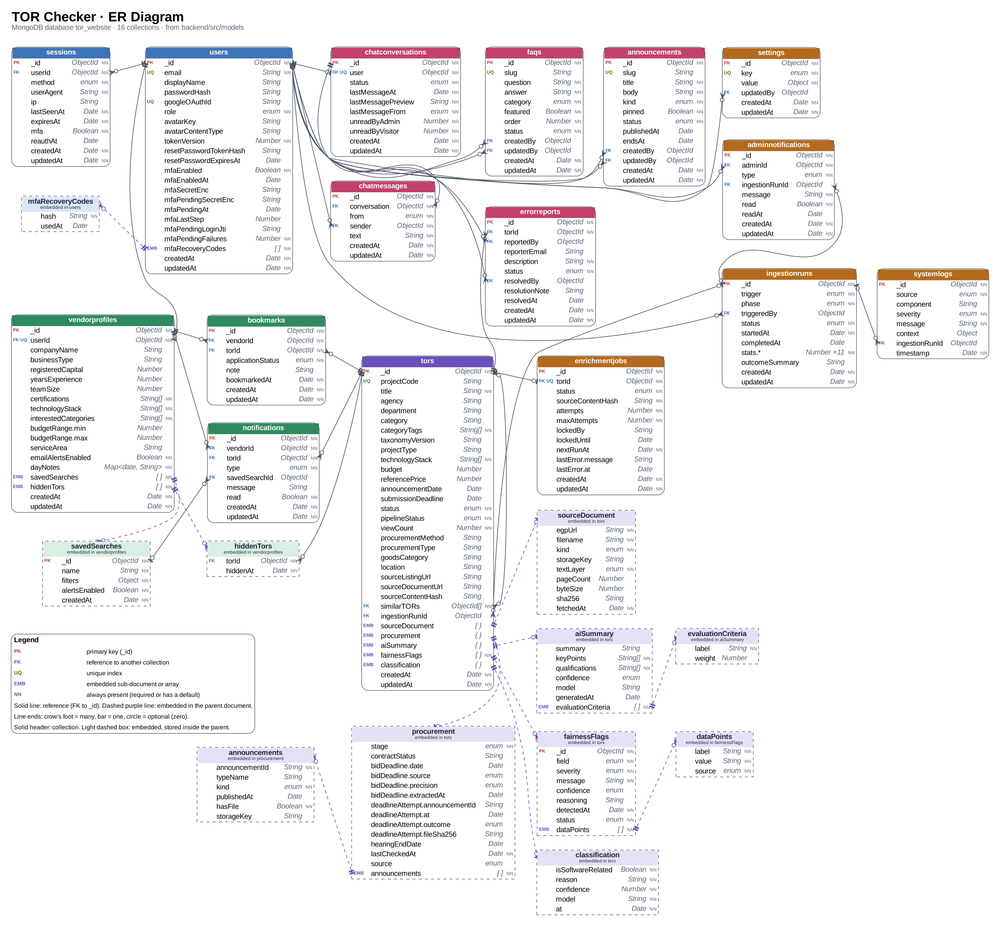

# ER Diagram

The physical data model of TOR Checker: every MongoDB collection, its fields and types, its keys, and how the collections reference each other. It is drawn from the Mongoose schemas in [`backend/src/models`](../../backend/src/models). The [domain model](domain-model.md) shows the same data as concepts; this diagram shows how it is actually stored.

[`er-diagram.svg`](er-diagram.svg) is the vector version and stays sharp at any zoom level.

## Notation

| Symbol | Meaning |
|---|---|
| Box with a solid header | A collection (a "table"), named as it is in MongoDB |
| Light dashed box | An embedded sub-document or array. It is stored inside its parent document, not as its own collection |
| **PK** | Primary key, the `_id` MongoDB gives every document |
| **FK** | Holds the `_id` of a document in another collection |
| **UQ** | Has a unique index |
| **EMB** | The field that holds an embedded box: `{ }` for one sub-document, `[ ]` for an array |
| NN | Always present: required, or always filled with a default |
| Solid line | A reference, from the FK field to the `_id` it points to |
| Dashed purple line | Embedding, from the parent's field to the embedded box |
| Line ends | Crow's foot = many, bar = exactly one, circle = optional (zero allowed) |

Types are the Mongoose types: `ObjectId`, `String`, `Number`, `Boolean`, `Date`, `Object` (free-form), `X[]` for an array of X, and `enum` for a string limited to the values listed [below](#enum-values). A dotted name such as `budgetRange.min` is a field of a small nested object, shown inline.

## Collections

The *Requirements* column names the functional requirements in the [SRS](../SRS.md) that each collection stores data for. A dash means it supports a use case with no FR yet; see [traceability](README.md#traceability-to-requirements-and-issues).

| Collection | Holds | Notable indexes | Requirements |
|---|---|---|---|
| `users` | Every account, vendor or admin, with password, Google link and two-step verification fields | `email` unique; `googleOAuthId` unique where set | FR-21 |
| `sessions` | One row per signed-in device | `userId`; TTL on `expiresAt` deletes expired sessions automatically | — |
| `vendorprofiles` | A vendor's business profile, saved searches, hidden TORs and calendar notes | `userId` unique (one profile per user) | FR-22, FR-23, FR-28 |
| `bookmarks` | Saved TORs and their application status | `{ vendorId, torId }` unique | FR-27, FR-31 – FR-33 |
| `notifications` | In-app alerts for vendors | `{ vendorId, read, createdAt }` | FR-30 |
| `tors` | TOR projects with everything the pipeline adds: the document, procurement stage, AI summary, fairness flags, classification | `projectCode` unique where set; text index on `title` and `agency`; `category`, `agency`, `pipelineStatus` (each with `announcementDate`); `categoryTags`; `technologyStack`; `procurement.stage`; `procurement.lastCheckedAt` | FR-1 – FR-20, FR-42, FR-43 |
| `errorreports` | Reports that a TOR's data is wrong | `torId`; `status` | FR-40, FR-41 |
| `chatconversations` | One chat thread per user | `user` unique; `lastMessageAt` | — |
| `chatmessages` | Messages in a thread | `{ conversation, _id }` | — |
| `faqs` | Help-center questions and answers | `slug` unique where set; `{ status, category, order }` | — |
| `announcements` | Help-center news, updates and maintenance notices | `slug` unique where set; `{ status, pinned, publishedAt }` | — |
| `ingestionruns` | One row per discovery, enrichment, lifecycle or capture run, with counters in `stats.*` | `startedAt`; `phase`; `status` | FR-34 – FR-36 |
| `enrichmentjobs` | The AI work queue: one job per TOR, with retries and a lock | `torId` unique; `{ status, nextRunAt, lockedUntil }` | FR-12, FR-15 |
| `adminnotifications` | Pipeline alerts, one copy per admin | `{ adminId, read, createdAt }` | FR-39 |
| `systemlogs` | Ingestion, AI pipeline and application logs shown on the admin logs page | `source`; `severity`; `timestamp` | FR-37, FR-38 |
| `settings` | Admin-editable settings, one document per key (today only `fairness-prefilter`) | `key` unique | FR-20 |

## Relationships

MongoDB has no foreign-key constraints. The references below are kept correct by the application, which checks that a referenced document exists before saving and cleans up in a transaction when an account is deleted.

| From | To | Cardinality | Notes |
|---|---|---|---|
| `sessions.userId` | `users` | many to 1 | |
| `vendorprofiles.userId` | `users` | 0..1 to 1 | Created on a vendor's first profile request |
| `bookmarks.vendorId` | `vendorprofiles` | many to 1 | References the profile, not the user |
| `bookmarks.torId` | `tors` | many to 1 | |
| `notifications.vendorId` | `vendorprofiles` | many to 1 | |
| `notifications.torId` | `tors` | many to 1 | |
| `notifications.savedSearchId` | `vendorprofiles.savedSearches._id` | many to 0..1 | Only for `saved_search_match`. Points into an embedded array, so it isn't a Mongoose `ref` |
| `vendorprofiles.hiddenTors.torId` | `tors` | many to 1 | |
| `errorreports.torId` | `tors` | many to 1 | |
| `errorreports.reportedBy` | `users` | many to 0..1 | Null for a visitor without an account, or after the reporter deletes their account |
| `errorreports.resolvedBy` | `users` | many to 0..1 | Null until resolved |
| `chatconversations.user` | `users` | 0..1 to 1 | |
| `chatmessages.conversation` | `chatconversations` | many to 1 | |
| `chatmessages.sender` | `users` | many to 1 | The user or the admin who wrote it |
| `faqs.createdBy`, `faqs.updatedBy` | `users` | many to 0..1 | The admin |
| `announcements.createdBy`, `announcements.updatedBy` | `users` | many to 0..1 | The admin |
| `ingestionruns.triggeredBy` | `users` | many to 0..1 | Null for scheduled runs |
| `tors.ingestionRunId` | `ingestionruns` | many to 0..1 | The run that found the TOR |
| `tors.similarTORs` | `tors` | many to many | Self-reference, an array of ids |
| `enrichmentjobs.torId` | `tors` | 0..1 to 1 | At most one queue entry per TOR |
| `adminnotifications.adminId` | `users` | many to 1 | |
| `adminnotifications.ingestionRunId` | `ingestionruns` | many to 0..1 | |
| `systemlogs.ingestionRunId` | `ingestionruns` | many to 0..1 | Only for pipeline logs |
| `settings.updatedBy` | `users` | many to 0..1 | The admin who last changed it |

### Embedded documents

| Parent | Embedded | Cardinality |
|---|---|---|
| `users` | `mfaRecoveryCodes` | 0..* (10 after setup) |
| `vendorprofiles` | `savedSearches` | 0..50 |
| `vendorprofiles` | `hiddenTors` | 0..1000 |
| `vendorprofiles` | `dayNotes` (a map from `YYYY-MM-DD` to the note) | 0..1000 |
| `tors` | `sourceDocument` | 0..1, set once the PDF is fetched |
| `tors` | `procurement` | 0..1, set by the first lifecycle refresh |
| `procurement` | `announcements` | 0..* |
| `tors` | `aiSummary` | 0..1, set by enrichment |
| `aiSummary` | `evaluationCriteria` | 0..* |
| `tors` | `fairnessFlags` | 0..* |
| `fairnessFlags` | `dataPoints` | 0..* (absent on flags made before the field existed) |
| `tors` | `classification` | 0..1, set by enrichment |

## Embed or reference

Data is embedded when it belongs to one parent, is always read with it and stays small; it is a separate collection when it grows without limit, is queried on its own, or has its own lifecycle.

| Data | Choice | Why |
|---|---|---|
| A TOR's document, procurement, AI summary, fairness flags, classification | Embedded in `tors` | Always shown with the TOR, written by the pipeline as a whole, bounded in size. One read serves the detail page. |
| Saved searches, hidden TORs, day notes | Embedded in `vendorprofiles` | Small, capped lists (50, 1,000, 1,000) that are only read for their owner |
| Recovery codes | Embedded in `users` | Ten per user, only used while signing in |
| Bookmarks, notifications | Own collections | Grow over time, paged and filtered on their own, and each points at a TOR |
| Chat messages | Own collection | A thread can grow without limit; messages are paged with `after` |
| Sessions | Own collection | Looked up on every request by id, and expire on their own through a TTL index |
| Enrichment jobs | Own collection | A work queue that the jobs lock and update atomically, separate from the TOR document they work on |

## Enum values

| Field | Values |
|---|---|
| `users.role` | `vendor`, `admin` |
| `sessions.method` | `password`, `google` |
| `bookmarks.applicationStatus` | `interested`, `preparing`, `submitted`, `missed` |
| `notifications.type` | `profile_match`, `saved_search_match`, `deadline_reminder` |
| `tors.status` | `open`, `closing_soon`, `closed` |
| `tors.pipelineStatus` | `pending`, `processing`, `enriched`, `rejected`, `failed` |
| `sourceDocument.kind` | `tor`, `invitation` |
| `sourceDocument.textLayer` | `digital`, `scanned`, `unreadable`, `missing` |
| `procurement.stage` | `draft`, `inviting`, `awarded`, `cancelled` |
| `procurement.source` | `egp2`, `gproc` |
| `procurement.bidDeadline.source` | `invitation-pdf`, `admin` |
| `procurement.bidDeadline.precision` | `day`, `month` |
| `procurement.deadlineAttempt.outcome` | `read`, `unreadable` |
| `procurement.announcements.kind` | `tor-draft`, `bidding-draft`, `reference-price`, `invitation`, `cancellation`, `winner`, `plan`, `unknown` |
| `aiSummary.confidence`, `fairnessFlags.confidence` | `high`, `medium`, `low` |
| `fairnessFlags.field` | `budget`, `deadline`, `category`, `agency`, `title`, `qualificationRequirements`, `other` |
| `fairnessFlags.severity` | `low`, `medium`, `high` |
| `fairnessFlags.status` | `open`, `acknowledged`, `dismissed` |
| `dataPoints.source` | `system`, `ai` |
| `errorreports.status` | `open`, `resolved` |
| `chatconversations.status` | `open`, `closed` |
| `chatconversations.lastMessageFrom`, `chatmessages.from` | `visitor`, `admin` |
| `faqs.category` | `getting-started`, `search`, `tor-details`, `ai-summary`, `vendor-profile`, `saved-tracking`, `account-security`, `data-reports` |
| `faqs.status`, `announcements.status` | `draft`, `published` |
| `announcements.kind` | `news`, `update`, `maintenance` |
| `ingestionruns.trigger` | `scheduled`, `manual` |
| `ingestionruns.phase` | `discovery`, `enrichment`, `lifecycle`, `capture` |
| `ingestionruns.status` | `running`, `success`, `partial`, `failed` |
| `enrichmentjobs.status` | `queued`, `processing`, `done`, `failed`, `rejected` |
| `adminnotifications.type` | `pipeline_run_failed` |
| `systemlogs.source` | `ingestion`, `ai-pipeline`, `application` |
| `systemlogs.severity` | `info`, `warning`, `error` |
| `settings.key` | `fairness-prefilter` |

## Deleting data

| Action | What happens |
|---|---|
| A vendor deletes their account | In one transaction: their bookmarks, notifications, profile, chat thread and messages, and sessions are deleted, and `reportedBy` on their error reports is set to null. The avatar file is removed from Cloud Storage afterwards. |
| An admin removes a TOR | The TOR isn't deleted. Its `pipelineStatus` becomes `rejected`, which hides it from the public site and stops the next discovery run from adding it again. |
| A session expires | MongoDB deletes it through the TTL index on `expiresAt`. |

## Notes

- Secret fields (`passwordHash`, `resetPasswordTokenHash`, `mfaSecretEnc`, `mfaPendingSecretEnc`, `mfaRecoveryCodes` and the other pending-sign-in fields) are never selected by default and never returned by the API. Two-step secrets are encrypted with `MFA_ENCRYPTION_KEY`; codes and tokens are stored as hashes.
- `deadline_reminder` is allowed in `notifications.type`, but nothing creates that type yet.
- `similarTORs` is in the schema, but nothing fills it yet.
- `ingestionruns.stats.*` is 11 counters: `torsFound`, `torsCreated`, `torsUpdated`, `torsFailed`, `torsSkipped`, `torsUnchanged`, `enrichedOk`, `enrichedRejected`, `enrichedFailed`, `enrichmentPlanned`, `enrichmentRetried`.
