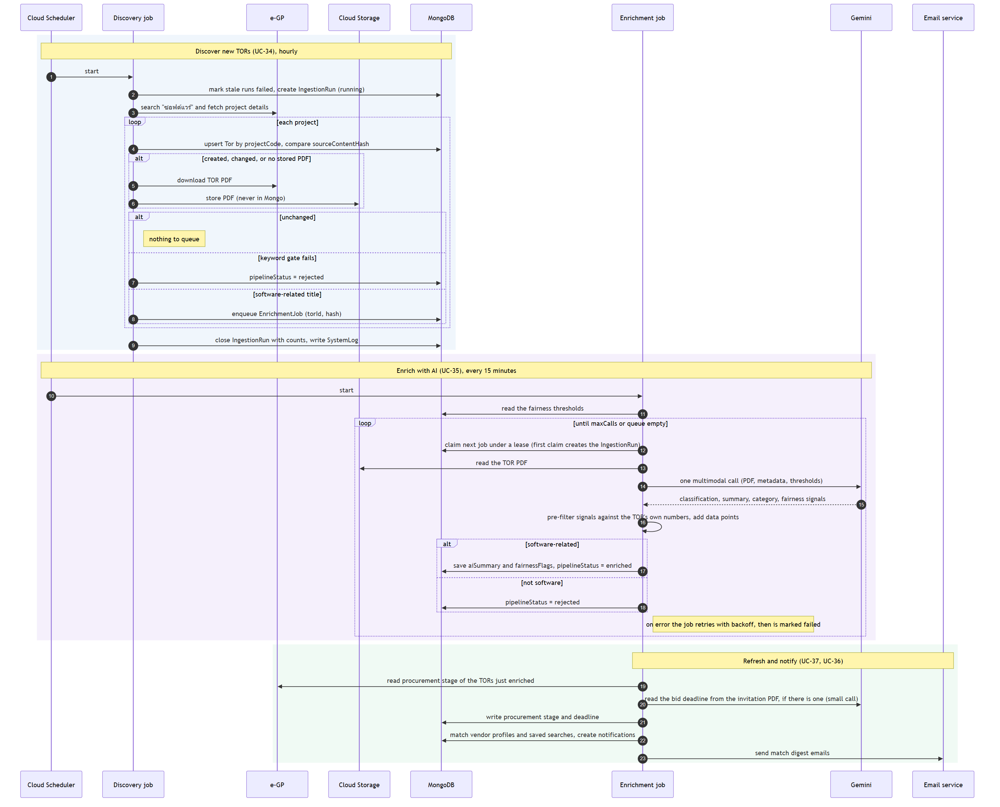
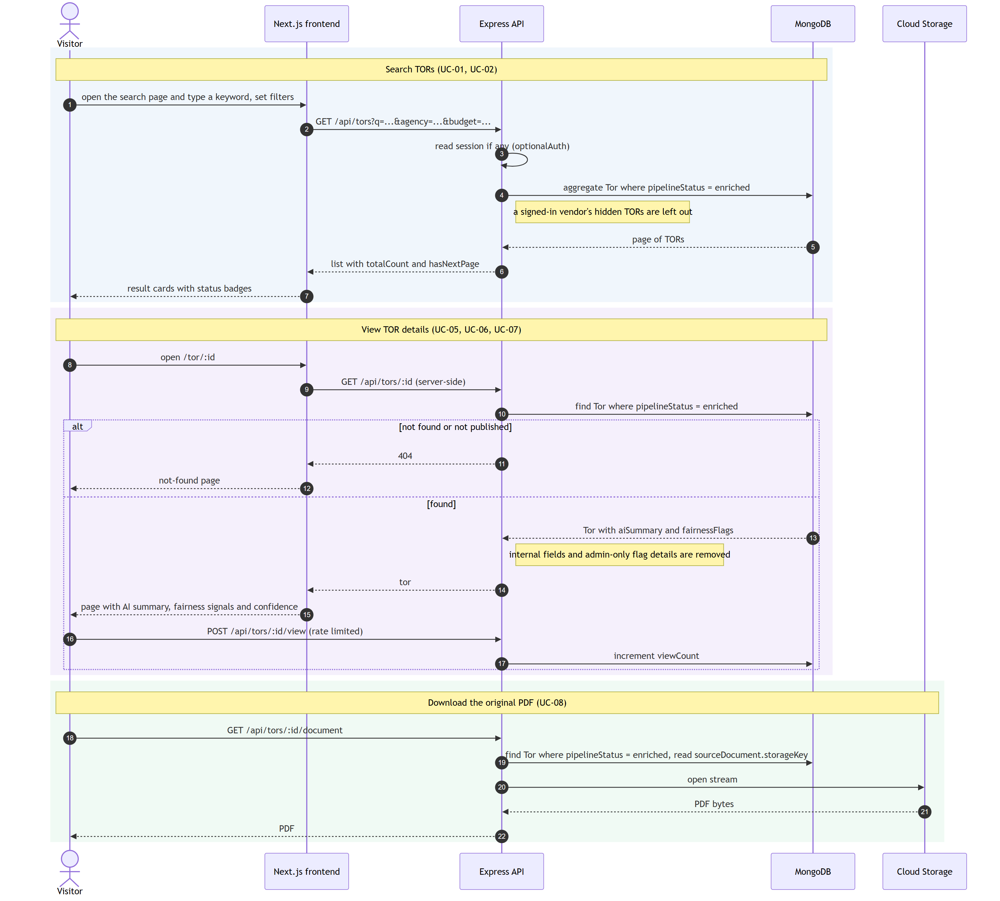
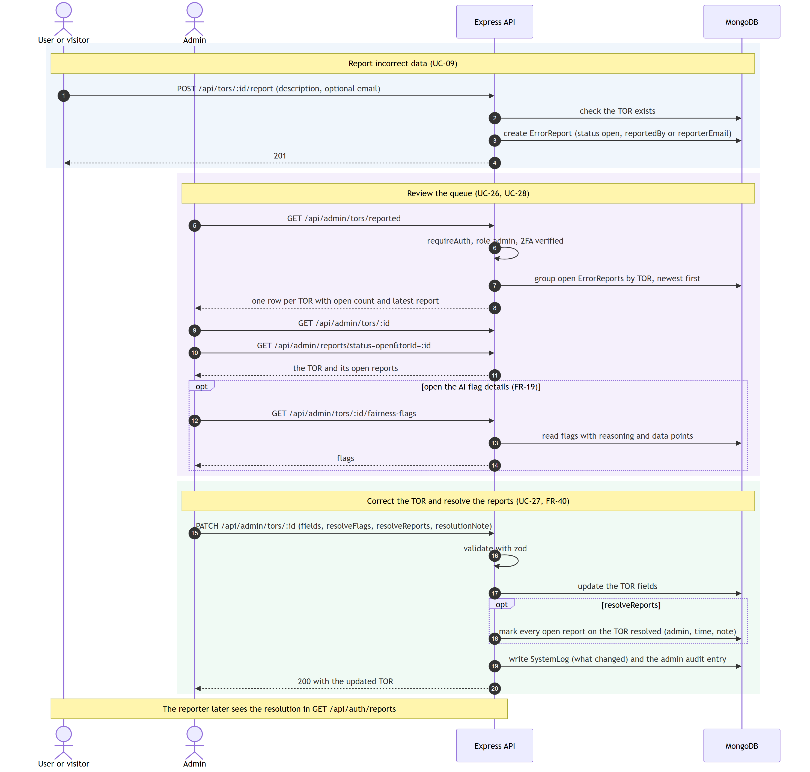
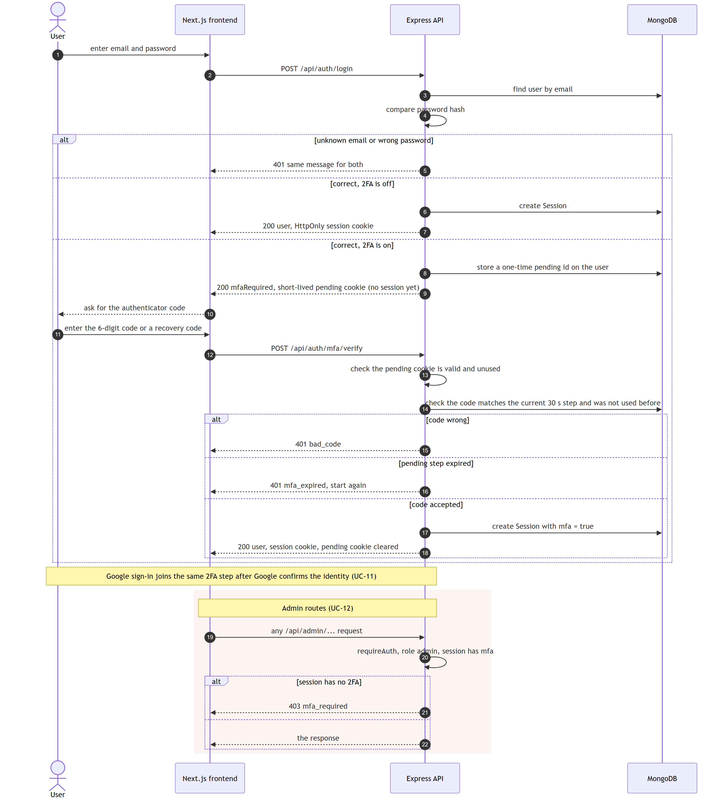

# Sequence Diagrams

How the parts of TOR Checker talk to each other over time, for the flows that matter most. Each diagram is drawn from the code ([`backend/src`](../../backend/src) and [`frontend/src`](../../frontend/src)) and uses the use case numbers from the [use case model](README.md). The parts and where they run are in the [system design](system-design.md), the classes behind them in the [class diagram](class-diagram.md), and every endpoint in the [API reference](api.md).

| # | Diagram | Use cases |
|---|---|---|
| 1 | [Discover, enrich and notify](#1-discover-enrich-and-notify) | UC-34, UC-35, UC-36, UC-37 |
| 2 | [Search and view a TOR](#2-search-and-view-a-tor) | UC-01, UC-02, UC-05 to UC-08 |
| 3 | [Report incorrect data and resolve it](#3-report-incorrect-data-and-resolve-it) | UC-09, UC-26, UC-27, UC-28 |
| 4 | [Sign in with two-step verification](#4-sign-in-with-two-step-verification) | UC-10, UC-11, UC-12 |

## Notation

| Symbol | Meaning |
|---|---|
| Solid arrow | A call or request |
| Dashed arrow | A response |
| `alt` / `else` | One of several branches runs |
| `opt` | The step runs only when the condition holds |
| `loop` | The steps repeat |
| Arrow back to the same box | The part does the work itself |

Each diagram's text source is in [`sequence/`](sequence). The pictures are rendered from it with [mermaid-cli](https://github.com/mermaid-js/mermaid-cli), so to change a diagram, edit the `.mmd` file and render it again:

```sh
mmdc -i sequence/1-pipeline.mmd -o sequence-diagram-1-pipeline.svg -b white
mmdc -i sequence/1-pipeline.mmd -o sequence-diagram-1-pipeline.png -b white -w 1500 -s 2
```

## 1. Discover, enrich and notify



[`sequence-diagram-1-pipeline.svg`](sequence-diagram-1-pipeline.svg) is the vector version. Source: [`1-pipeline.mmd`](sequence/1-pipeline.mmd).

The data pipeline runs as scheduled Cloud Run jobs, with no user involved. It has three stages, each cheaper than the next so that Gemini only sees TORs that need it:

1. **Discovery** (hourly) searches e-GP, saves each project, stores its PDF in Cloud Storage and queues it for AI. A TOR whose content hash has not changed is left alone, and a title that fails the keyword gate is marked `rejected` without any AI call.
2. **Enrichment** (every 15 minutes) takes queued jobs under a lease and makes one Gemini call per TOR. The model proposes fairness signals, then the code checks them against the TOR's own numbers and the thresholds an administrator set (FR-20), keeps the ones that pass, and stores the numbers behind each one. A failed job is retried with a growing delay.
3. **Refresh and notify** runs for exactly the TORs just enriched: it reads the procurement stage and bid deadline from e-GP, then matches the new TORs against vendor profiles and saved searches and sends the digest emails. A separate daily lifecycle job (not drawn) does the same refresh for older open TORs.

## 2. Search and view a TOR



[`sequence-diagram-2-search-view.svg`](sequence-diagram-2-search-view.svg) is the vector version. Source: [`2-search-view.mmd`](sequence/2-search-view.mmd).

Everything a visitor sees goes through the API, and the API only returns TORs whose `pipelineStatus` is `enriched`, so a TOR that is still queued, rejected or hidden by an admin never appears, and its PDF cannot be fetched either. The detail page is rendered on the server, which asks the API itself. The API removes internal fields and the admin-only reasoning behind each fairness flag before it answers.

## 3. Report incorrect data and resolve it



[`sequence-diagram-3-report-resolve.svg`](sequence-diagram-3-report-resolve.svg) is the vector version. Source: [`3-report-resolve.mmd`](sequence/3-report-resolve.mmd).

Anyone can report a TOR, signed in or not (an anonymous reporter may leave an email). The admin queue groups open reports by TOR, so one TOR is one row however many people reported it. When the admin saves a correction with `resolveReports`, the TOR and all of its open reports change in the same request, so a TOR cannot be fixed while some reports stay open. The change is recorded in the system log and the admin audit trail. The optional flag-detail call shows the AI reasoning and data points to help the admin judge the TOR (FR-19).

## 4. Sign in with two-step verification



[`sequence-diagram-4-sign-in.svg`](sequence-diagram-4-sign-in.svg) is the vector version. Source: [`4-sign-in.mmd`](sequence/4-sign-in.mmd).

When 2FA is on, the password step does not create a session. It only sets a short-lived pending cookie tied to a one-time id stored on the user. The session is created after the second step accepts a code, and only a code for the current 30-second step that has not been used before. A wrong password and an unknown email get the same answer, so the response does not reveal which emails have an account. Admin routes also require the session to have passed 2FA. Sign in with Google reaches the same second step once Google has confirmed the identity.
