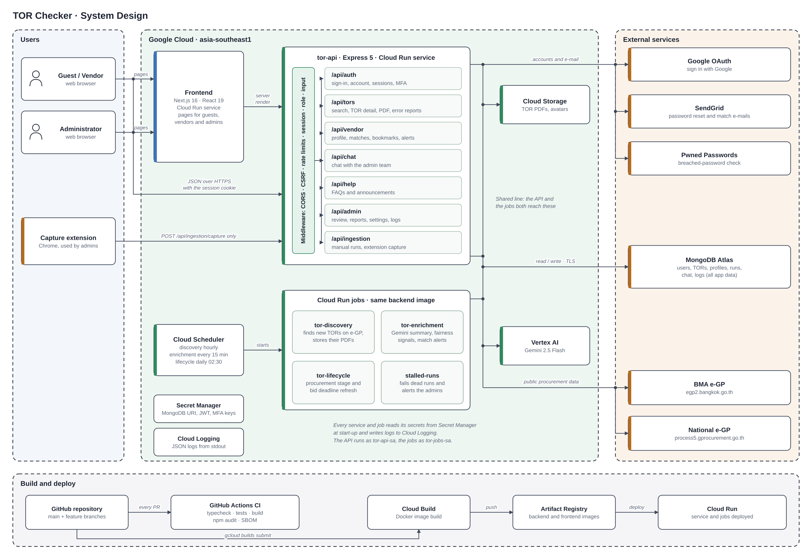

# System Design

How TOR Checker is built and deployed: the parts that run, where they run, and how they talk to each other and to the outside world. It is drawn from the code, [`docker-compose.yml`](../../docker-compose.yml) and the [deployment guide](../deployment/gcp.md). For what users do with the system see the [use case model](README.md), for the concepts it handles the [domain model](domain-model.md), and for every endpoint the [API reference](api.md).

[`system-design.svg`](system-design.svg) is the vector version and stays sharp at any zoom level.

## Overview

TOR Checker is one web application with a background data pipeline, running on Google Cloud:

- a **Next.js frontend** that renders the pages;
- one **Express API** that holds all the business logic, split into modules by route group;
- four **Cloud Run jobs** that bring TORs in from e-GP and process them with Gemini, built from the same image as the API;
- **managed services** for everything stateful: MongoDB Atlas for data, Cloud Storage for files, Secret Manager for secrets.

Unlike a microservice design, the API is a single service (a modular monolith). The modules share one database and one deployment, which suits a small team and a data model where almost every feature touches TORs. The long-running work is the part that needs to scale and fail separately, so that is what is split out into jobs.

## Components

| Component | Technology | Runs on | Responsibility |
|---|---|---|---|
| Frontend | Next.js 16 (App Router), React 19, Tailwind CSS v4 | Cloud Run service | Public, vendor and admin pages. Sets the Content-Security-Policy and other security headers. Has no database access. |
| API (`tor-api`) | Express 5, Mongoose 9, Zod, TypeScript | Cloud Run service | Every endpoint in the [API reference](api.md). Requests pass the middleware chain (CORS, CSRF origin check, rate limits, session, role, input validation) before reaching a module. Admin-started ingestion runs and extension captures also run here, in the background after a `202` answer. |
| `tor-discovery` | Same backend image, `dist/jobs/discovery.js` | Cloud Run job | Searches the BMA e-GP portal for new software TORs, saves them, stores their PDFs and queues them for AI. |
| `tor-enrichment` | `dist/jobs/enrichment.js` | Cloud Run job | Sends queued TORs to Gemini for the summary, classification and fairness signals; publishes the software TORs; notifies matching vendors; then refreshes the new TORs' procurement stage. |
| `tor-lifecycle` | `dist/jobs/lifecycle.js` | Cloud Run job | Checks each open TOR's procurement stage on e-GP and reads the bid deadline from its invitation PDF. |
| `stalled-runs` | `dist/jobs/stalledRuns.js` | Cloud Run job | Marks runs whose worker died as failed and alerts the admins. |
| Cloud Scheduler | | Google Cloud | Starts the jobs: discovery hourly, enrichment every 15 minutes, lifecycle daily at 02:30 Bangkok time. |
| Capture extension | Chrome extension (Manifest V3) | Admin's browser | Collects project numbers from the national e-GP search page and sends them to `POST /api/ingestion/capture`. |
| MongoDB Atlas | MongoDB, M0 tier | MongoDB Atlas | All application data: users, sessions, TORs, profiles, chat, runs, logs. |
| Cloud Storage | One bucket | Google Cloud | TOR and invitation PDFs, profile pictures. |
| Vertex AI | Gemini 2.5 Flash | Google Cloud | Summaries, classification, fairness signals, bid deadlines. |
| Secret Manager | | Google Cloud | `MONGODB_URI`, `JWT_SECRET`, `MFA_ENCRYPTION_KEY` and the other secrets. |
| Cloud Logging | | Google Cloud | Application and security logs, written as JSON to stdout. |

## Connections

Who talks to whom. The full list with protocols, credentials and the outbound allowlist is in [communications.md](../security/communications.md).

| From | To | Why | Authentication |
|---|---|---|---|
| Browser | Frontend | Pages | None; the API decides access |
| Browser | API | JSON calls from the pages (`credentials: "include"`) | Session cookie `__Host-token` |
| Frontend server | API | Server rendering of public data (`INTERNAL_API_BASE_URL`) | None, public reads only |
| Capture extension | API | `POST /api/ingestion/capture` only | The admin's session cookie |
| Cloud Scheduler | Jobs | Start a run | `tor-jobs-sa` with `run.invoker` |
| API, jobs | MongoDB Atlas | All data | Database user over TLS |
| API, jobs | Cloud Storage | PDFs and avatars | Service account |
| API, jobs | Vertex AI | Gemini calls | Service account |
| API, jobs | BMA e-GP `egp2.bangkok.go.th` | TOR listings, announcements, PDFs | None (public) |
| API, jobs | National e-GP `process5.gprocurement.go.th` | Procurement stage, invitation PDFs, captures | None (public) |
| API | Google OAuth | Sign in with Google | Client id and secret, PKCE |
| API, enrichment job | SendGrid | Password-reset and match e-mails | API key |
| API | Pwned Passwords | Breached-password check (5 hash characters only) | None |

The API and the jobs run as two service accounts, `tor-api-sa` and `tor-jobs-sa`, each with only the roles it needs. Only the backend reaches the database; the frontend holds no database credentials.

## Main flows

### 1. A visitor searches TORs

1. The browser loads a page from the **frontend**.
2. The page calls `GET /api/tors` on the **API**. The middleware checks the origin, the rate limit and, if there is a cookie, the session.
3. The TOR module queries **MongoDB** and returns only public TORs, those the AI has processed and kept as software procurement.
4. Opening a TOR's PDF calls `GET /api/tors/:id/document`, which streams the file from **Cloud Storage**.

### 2. A user signs in

1. `POST /api/auth/login` checks the password and creates a session row in **MongoDB**.
2. The API sets an HttpOnly `__Host-token` cookie (a signed JWT that points to the session row).
3. If two-step verification is on, the API first answers `mfaRequired` and the user finishes with `POST /api/auth/mfa/verify`. Admin pages need a verified session.
4. Every later request checks the cookie and the session row, which ends after 30 idle minutes or 12 hours.

Signing in with Google goes through `GET /api/auth/google` to **Google OAuth** and back to the callback, which verifies the ID token before creating the session.

### 3. A new TOR enters the system

1. **Cloud Scheduler** starts `tor-discovery` every hour.
2. Discovery searches **BMA e-GP** for recent announcements from the configured agencies, saves new or changed projects to **MongoDB**, stores the PDF in **Cloud Storage** and queues the TOR for AI.
3. Every 15 minutes `tor-enrichment` takes up to `MAX_AI_CALLS_PER_RUN` queued TORs and sends each PDF to **Gemini**. The answer gives the summary, key points, evaluation criteria, a software/not-software decision and fairness signals, filtered by the admin's [fairness thresholds](api.md#put-apiadminsettingsfairness-prefilter).
4. Software TORs become public. Vendors whose profile or saved searches match get an in-app notification and, if they allow it, a digest e-mail through **SendGrid**.
5. Enrichment ends by asking e-GP (**national e-GP** first, then the BMA portal) for the new TORs' procurement stage.
6. Each night `tor-lifecycle` refreshes the stage and bid deadline of the TORs still in draft or open for bids.
7. A run that dies part-way is marked failed by `stalled-runs`, and every admin gets a pipeline alert.

Admins can start any of these runs from the admin pages through [`/api/ingestion`](api.md#ingestion). Those runs execute inside the API service, so it has the same e-GP, storage and Vertex AI settings as the jobs.

### 4. An admin captures projects with the extension

1. On the national e-GP search page, the extension collects project numbers.
2. It sends them to `POST /api/ingestion/capture` with the admin's session cookie. This is the only endpoint that accepts the extension's origin.
3. The API answers `202` and, in the background, downloads each project from **national e-GP**, stores the PDF and queues the TOR for AI, where it continues as in flow 3.

## Environments

| | Local development | Production |
|---|---|---|
| Started by | `docker compose up --build` | `gcloud run deploy` and `gcloud run jobs deploy` ([gcp.md](../deployment/gcp.md)) |
| Frontend | `frontend` container, port 3000, hot reload | Cloud Run service |
| API | `backend` container, port 8000, hot reload | Cloud Run service `tor-api`, 1 GiB, CPU always allocated so background runs keep going after the response |
| Jobs | Run by hand (`npm run job:*`) or from the admin pages | Cloud Run jobs, 30-minute timeout, no retries |
| Database | `mongo:7` container, or Atlas through `MONGODB_URI` | MongoDB Atlas |
| Files | The shared GCS bucket, read with each developer's own gcloud credentials | Cloud Storage through the service account |
| E-mail | `EMAIL_DRIVER=log`: written to the console | `EMAIL_DRIVER=sendgrid` |
| Secrets | Root `.env` file (git-ignored) | Secret Manager |

## Build and deploy

1. Work happens on a branch and reaches `main` through a pull request ([CONTRIBUTING.md](../../CONTRIBUTING.md)).
2. **GitHub Actions** runs on every pull request and on `main`: the backend is typechecked, tested and built, the frontend is built, and for both `npm audit` checks the production dependencies and a CycloneDX SBOM is saved.
3. **Cloud Build** builds the Docker images (`gcloud builds submit`). Each Dockerfile has a `runner` stage: `node dist/server.js` for the backend, the Next.js standalone server for the frontend.
4. The images go to **Artifact Registry** and are deployed to Cloud Run. The API and all four jobs use the same backend image with a different `--command` and `--args`.

## Design decisions

| Decision | Why |
|---|---|
| One API service, not microservices | A small team, one database and features that all revolve around TORs. Modules (`routes`, `controllers`, `services`) keep the code separated without the cost of network calls between services. |
| Background work as Cloud Run jobs | Discovery and enrichment can take many minutes and call slow government sites. As jobs they have a 30-minute timeout, use no API capacity, scale to zero, and a failure doesn't affect users. |
| One image for the API and the jobs | The jobs reuse the API's models and ingestion code; one build keeps them in step. |
| TORs are public only after AI enrichment | Discovery finds many non-software projects. Showing only what Gemini has processed and kept as software keeps search results relevant and every TOR complete with a summary. |
| Storage and e-mail behind interfaces | `STORAGE_DRIVER` (`gcs` or `local`) and `EMAIL_DRIVER` (`sendgrid` or `log`) let the same code run in production, in development and in tests. |
| Outbound allowlist in code | Cloud Run has no egress firewall without a paid VPC connector, so every outbound HTTP client may only call its own configured hosts ([communications.md](../security/communications.md#3-the-outbound-allowlist-asvs-1324-1325-136-1523)). |
| MongoDB Atlas M0 open to `0.0.0.0/0` | Cloud Run has no fixed outbound IP without a paid connector. A strong credential and TLS are the protection, and the database user should have `readWrite` on the application database only. |
| Frontend and API on separate hostnames | Keeps the session cookie scoped to the API host (`__Host-` prefix) and lets each set its own security headers. Cross-site writes are refused by the origin check. |

## Notes

- The `stalled-runs` job has an entry point (`npm run job:stalled-runs`) but the [deployment guide](../deployment/gcp.md) doesn't create it or its schedule yet. Until it does, stalled runs are still marked failed when an admin starts a run or opens the runs list.
- The frontend's production deployment (service name, environment variables) is not yet written up in the deployment guide.
