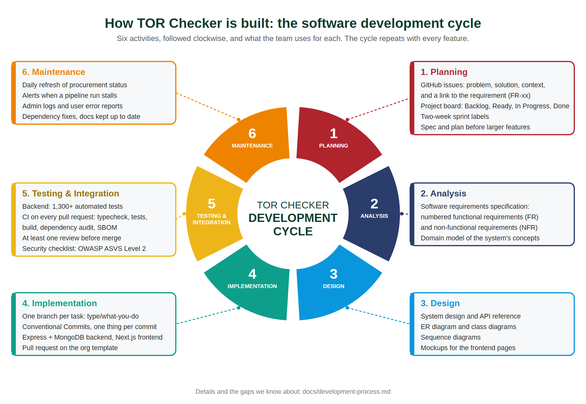

# Development Process

How TOR Checker is built, organized by the six activities of the software development cycle: planning, analysis, design, implementation, testing and integration, and maintenance. For each activity this page says what the team does today, where to find the result, and what is still missing. The numbers come from the repository and GitHub as of 11 November 2026.

[`development-cycle.svg`](development-cycle.svg) is the vector version.

The cycle is not run once. The project started on 9 August 2026 and has since had 601 commits on `main`, 91 issues (all closed) and 98 pull requests (94 merged). Every feature goes around the cycle on its own, from an issue to a merged pull request, and the larger ones get a written design first.

## At a glance

| # | Activity | What we do | Where to find it |
|---|---|---|---|
| 1 | Planning | Issues in a fixed format, a project board, 15-day sprints | GitHub issues and the SW-Process project board |
| 2 | Analysis | A requirements specification with numbered functional and non-functional requirements | The SRS, and the [domain model](design/domain-model.md) |
| 3 | Design | System, data, class and sequence diagrams, an API reference, a design spec for larger features | [`docs/design/`](design/README.md) and [`docs/superpowers/`](superpowers) |
| 4 | Implementation | A branch per task, Conventional Commits, pull requests with a template | [`CONTRIBUTING.md`](../CONTRIBUTING.md) and the code |
| 5 | Testing and integration | Backend tests, CI on every pull request, a review before merge | [`.github/workflows/`](../.github/workflows) and the backend tests |
| 6 | Maintenance | Scheduled refresh jobs, alerts, logs, user error reports | [`docs/deployment/gcp.md`](deployment/gcp.md), the admin panel |

## 1. Planning

**What we do.** Work starts as a GitHub issue with four fixed parts: the problem, the proposed solution, extra context, and traceability. Traceability names the requirement the issue implements (for example FR-19) and carries the matching `FR-xx` label, so every feature can be followed back to the specification. There are 40 or more different requirement labels in use. Issues sit on the SW-Process project board (Backlog, Ready, In Progress, Done) and the work was planned in six sprints of 15 days (11 August to 8 November), set in the board's Sprint field. Each sprint is reviewed in [`docs/process/retrospectives.md`](process/retrospectives.md).

Before a larger feature, the team writes a design spec and then an implementation plan. There are six specs and nine plans so far, for example the [fairness flag detection spec](superpowers/specs/2026-09-08-fairness-flag-detection-design.md) and its [plan](superpowers/plans/2026-09-08-fairness-flag-detection.md).

What each sprint delivered, and which issues cover each requirement, is in [`docs/process/deliverables.md`](process/deliverables.md).

**Missing.** 17 of the 99 items on the board have no sprint set. 16 of them are draft items that only point a requirement to its issue ("FR-43 → see #11"), so they need no sprint. The other one is issue [#188](https://github.com/SW-Process/TOR_website/issues/188), opened on 10 November to record user feedback handled in October.

## 2. Analysis

**What we do.** The requirements are in the [software requirements specification](SRS.md) (SRS) with numbered functional requirements (FR-01 and up) and non-functional requirements (NFR). Code comments and issues refer to these numbers, for example `FR-40` on the admin queue of reported TORs. The [domain model](design/domain-model.md) shows the concepts of the system and how they relate.

Every one of FR-1 to FR-43 has at least one issue on the board (see [deliverables](process/deliverables.md#3-requirement-coverage)).

**Missing.** The SRS uses `FR-1`, while issues and labels use `FR-01`. Both mean the same requirement, but a plain text search for one form misses the other.

## 3. Design

**What we do.** The design lives in [`docs/design/`](design/README.md), drawn from the code so it can be checked:

- [System design](design/system-design.md): the parts, where they run, how they connect.
- [ER diagram](design/er-diagram.md): the data stored in MongoDB.
- [Class diagrams](design/class-diagram.md): the pipeline and the request handling.
- [Sequence diagrams](design/sequence-diagram.md): the main flows in order, including one for the whole system.
- [API reference](design/api.md): every endpoint.

For the frontend, pages are built from existing mockups rather than designed on the spot. The mockups are in SRS §3.4 (images in [`docs/srs-images/`](srs-images)). Choices that matter are written down before coding, as in the issue for admin fairness flag details, which asked "decide whether extra fields are needed" and was settled while implementing it.

**Missing.** The design documents were drawn from the code near the end of the project (5 to 10 November), so they record the system as built rather than guiding it from the start. The links from issues to them were also added afterwards, on 12 November: 82 of the 91 issues now have a *Design reference* section. The other nine are the proposal, the SRS, the slides, the three mockup issues (which link the SRS mockups instead), the CI and TypeScript setup, and a test issue.

## 4. Implementation

**What we do.** The rules are in [`CONTRIBUTING.md`](../CONTRIBUTING.md):

- One branch per task, named `<type>/<what-you-are-doing>`, always from `main`. Nobody pushes to `main` directly.
- Commits follow Conventional Commits, one thing per commit, for example `feat(backend): add admin endpoint for full fairness flag details`.
- Work lands through a pull request into `main` that uses the organization's template (type of change, description, changes made, how to test, checklist).
- A new environment variable must also be added to `.env.example`.

The backend is Express 5 with MongoDB, the frontend is Next.js, and both are TypeScript. The ingestion, enrichment and lifecycle jobs are separate entry points built from the same code as the API.

## 5. Testing and integration

**What we do.**

- **Tests.** The backend has 104 test files with more than 1,300 tests, running against an in-memory MongoDB so no database service is needed.
- **Continuous integration.** [`ci.yml`](../.github/workflows/ci.yml) runs on every pull request into `main` and on every push to `main`. The backend job runs type checking, the tests and the build, and the frontend job runs the build.
- **Review.** All 94 merged pull requests have at least one review, as `CONTRIBUTING.md` requires. Pull request #173 below, for example, was approved and merged by a teammate, not by its author.

**Missing.**

- The review rule is only a convention. `main` has no branch protection, so GitHub does not block a merge when CI fails or when nobody has approved. [`.github/workflows/README.md`](../.github/workflows/README.md) already explains how to switch it on.
- The frontend has no automated tests. Its CI job only builds. `npm run lint` is not run in CI. That page says lint reports 9 errors, but it is clean now, so the step can be added back and the note removed.
- There are no end-to-end tests that drive the site in a browser.

## 6. Maintenance

**What we do.** Much of the upkeep is built into the system:

- A daily lifecycle job re-checks open TORs on e-GP and updates their stage and bid deadline.
- A stalled-runs job marks pipeline runs that stopped making progress as failed and alerts every admin in the admin panel and by email.
- Admins read the system logs, and users can report wrong data on a TOR. Admins correct it and close the report from a queue.
- Deployment steps and schedules are in [`docs/deployment/gcp.md`](deployment/gcp.md).

**Missing.** There is no automated deployment: the guide uses `gcloud` commands, so releasing is a manual step. Vendors get match alerts, but nothing in the code sends deadline reminders yet, although the notification type exists.

## One feature through the cycle

Issue [#111](https://github.com/SW-Process/TOR_website/issues/111), "admin endpoint for full fairness flag details", went around the cycle like this:

| Activity | What happened |
|---|---|
| Planning | The issue was opened with the problem, the solution and traceability to FR-19, then moved across the board. |
| Analysis | FR-19 says an admin can see the data points and reasoning behind a fairness flag. The open question was whether the data model needed new fields. |
| Design | The decision was to store `reasoning` and `dataPoints` on each flag, keep them admin-only and leave them out of the public API. |
| Implementation | Work was done on `feat/admin-fairness-flag-details` in two commits (backend, then the panel from #112) and opened as pull request #173. |
| Testing and integration | New tests cover the endpoint, the data and the check that the public API does not expose these fields. CI ran, a teammate approved it and merged it. |
| Maintenance | Flags created before the change have no details until their TOR is enriched again. The admin panel says so instead of hiding the gap. |

## Where to improve first

In order of effect:

1. Turn on branch protection for `main` with the two CI checks and one required review.
2. Add the frontend lint step to CI and fix the outdated note about it.
3. Add tests for the frontend, and a few end-to-end checks of the main flows (search, sign in, admin correction).
4. Fill in the *Design reference* section when an issue is opened, not afterwards, and write `Closes #xx` in every pull request.
5. Either build the deadline reminder or remove its notification type.
