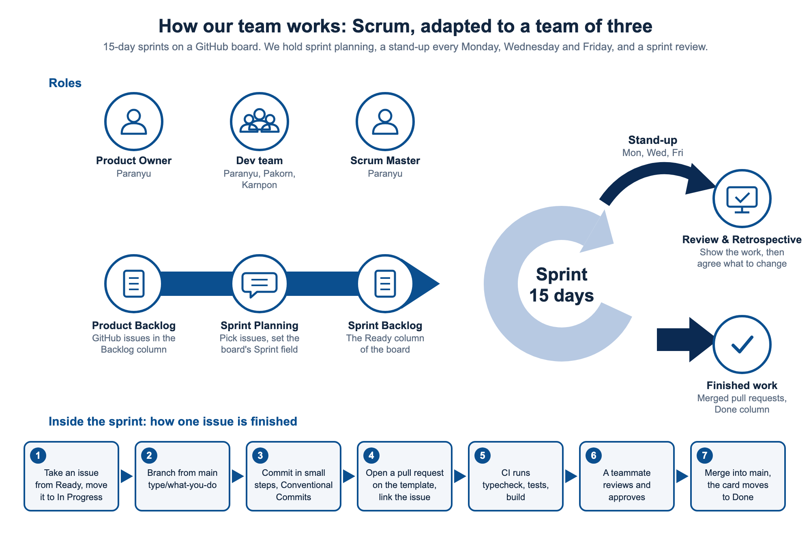

# Scrum Workflow

How the team works. We started from Scrum and adapted it to a team of three. The diagram shows the whole workflow; the sections below explain each part and where it differs from standard Scrum.



[`scrum-workflow.svg`](scrum-workflow.svg) is the vector version.

## Roles

| Scrum role | Who | Notes |
|---|---|---|
| Product Owner | Paranyu | Keeps the backlog and decides what comes first |
| Scrum Master | Paranyu | Holds the same person as the Product Owner, because the team has only three members |
| Dev team | Paranyu, Pakorn, Karnpon | Everyone builds, reviews and tests |

One person holds two roles, so there is no second view on priorities. Reviews of each other's pull requests make up for part of that.

## The sprint cycle

| Scrum element | How we do it | Where to see it |
|---|---|---|
| Product backlog | Every piece of work is a GitHub issue with a problem, a solution, context and a link to the requirement it implements (for example FR-19) | Issues, and the Backlog column of the project board |
| Sprint planning meeting | The team picks issues for the sprint, sets the board's **Sprint** field and moves them to the Ready column, once each one meets the [Definition of Ready](#definition-of-ready) | The Sprint field and the Ready (Sprint backlog) column of the project board |
| Sprint backlog | The issues in the Ready column | The project board |
| Sprint | 15 days. Six sprints ran from 11 Aug to 8 Nov 2026. Sprints 3 and 4 were tracked with `sprint: ...` labels at first; after Sprint 4 the team moved to the board's Sprint (iteration) field, which now covers all six sprints | The board's *Sprint* and *Sprint Summary* views |
| Stand-up | A short check-in on what is done, what is next and what blocks, every Monday, Wednesday and Friday | Held by the team, no trace in the repository |
| Sprint review | At the end of the sprint the team shows the finished work | Held by the team, no trace in the repository |
| Sprint retrospective | At the end of the sprint the team looks at what went well and what to change, and sets action items for the next sprint. Sprint 5 had a retrospective meeting; the other sprints were reviewed afterwards from the board and the git history | [`process/retrospectives.md`](process/retrospectives.md) |
| Finished work | Pull requests merged into `main`, with the card in the Done column | Merged pull requests and the Done column |

The planning, stand-up and review meetings were confirmed by the team. They leave no record in the repository, so this page cannot show their dates or notes. The retrospectives are the exception: they are written up in [`process/retrospectives.md`](process/retrospectives.md).

## Definition of Ready

An issue moves from **Backlog (Product backlog)** to **Ready (Sprint backlog)** only when it has everything below. The Product Owner checks this during sprint planning. Anyone who picks up an issue that is missing something moves it back to Backlog and says what is missing in a comment.

| # | The issue has | What that means |
|---|---|---|
| 1 | A clear problem | The *Problem / Motivation* section says who is affected and why it matters, not only the solution |
| 2 | A design reference | A link to what the work must follow: the SRS section, the spec in `docs/superpowers/specs/`, a page in `docs/design/` (API, ER, class or sequence diagram) or the mockup. If no design applies, write `None needed:` and the reason |
| 3 | Acceptance criteria | A checklist of outcomes a reviewer can test, for example "an invalid value is rejected with a message" |
| 4 | Traceability | The FR (and UC or NFR, if any) in the *Traceability* section, and the same FR in the board's **FR** field |
| 5 | An estimate | Hours in the board's **Time** field. An issue over 4 hours is split into sub-issues |
| 6 | A priority | **Priority** set to HIGH, MEDIUM or LOW |
| 7 | Its dependencies | `Blocked by #…` or `Part of #…` when it depends on other work. A blocked issue stays in Backlog until the blocker is done |
| 8 | An owner | One assignee |

**Work that starts from a spec.** A feature with a spec in `docs/superpowers/specs/` gets one parent issue that links the spec. The tasks are sub-issues of it, so the board's *Sub-issues progress* shows how far the feature is, and work done from the spec is never off the board.

**Example.** An issue that meets the definition:

```markdown
### Problem / Motivation
Admins can't change the fairness pre-filter thresholds, so the pipeline always uses the defaults.

### Design reference
- SRS §6.2, FR-20
- Spec: docs/superpowers/specs/2026-09-08-fairness-flag-detection-design.md
- API: docs/design/api.md, GET/PUT /api/admin/settings/fairness-prefilter

### Acceptance criteria
- [ ] /admin/settings shows the current values and the defaults
- [ ] Out-of-range values are rejected with a message
- [ ] Saved values persist after a reload
- [ ] The next enrichment run uses the new values

### Traceability
Maps to FR-20 (SRS §6.2)

### Dependencies
Blocked by #116 (thresholds API)
```

## One issue, from start to finish

The strip at the bottom of the diagram is what happens inside a sprint for each issue. The rules are in [`CONTRIBUTING.md`](../CONTRIBUTING.md).

1. Take an issue from the Ready column (it meets the [Definition of Ready](#definition-of-ready)) and move it to In Progress.
2. Branch from `main`, named `<type>/<what-you-are-doing>`. Nobody pushes to `main` directly.
3. Commit in small steps. Each commit does one thing and follows Conventional Commits.
4. Open a pull request into `main` on the organization's template, and link the issue.
5. CI runs type checking, tests and the build. It runs on every pull request.
6. A teammate reviews and approves. 87 of the 89 pull requests so far have at least one review.
7. The pull request is merged into `main` and the card moves to Done.

## How we differ from standard Scrum

- **Not every sprint had a retrospective meeting.** Only Sprint 5 did; the others were reviewed afterwards in [`process/retrospectives.md`](process/retrospectives.md). Holding the meeting at the end of every sprint is the biggest gap left against Scrum.
- **One person is Product Owner and Scrum Master.** See the roles above.
- **The stand-up is three times a week, not daily.** Scrum asks for a daily one. On the days without a stand-up, someone who is blocked has to wait or ask in the chat.
- **The 15-day length is a team choice.** Scrum allows one to four weeks.
- **Reviews are a team rule, not enforced.** GitHub does not block a merge without approval, because `main` has no branch protection.
