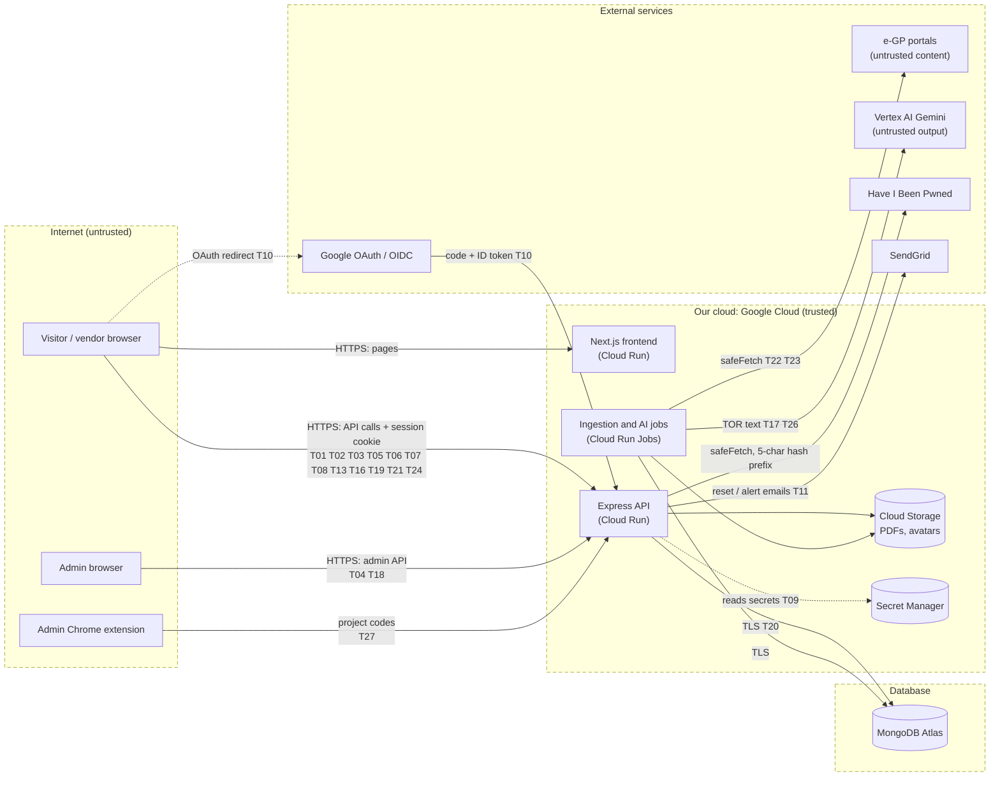

# Threat Model

This document lists the threats to TOR Checker, how each one was rated, the order in which the mitigations were implemented, and the risks that remain. It uses **STRIDE** to find threats and **Likelihood × Impact** to rank them.

Related documents: [trust boundaries and defense in depth](README.md#trust-boundaries), [authentication threats](authentication-defenses.md), [system design](../design/system-design.md).

## 1. Method

We walked the data-flow diagram (section 2) element by element and asked, for each one, which of the six STRIDE categories applies: **S**poofing, **T**ampering, **R**epudiation, **I**nformation disclosure, **D**enial of service and **E**levation of privilege.

Each threat is rated:

| | 1 (Low) | 2 (Medium) | 3 (High) |
| --- | --- | --- | --- |
| **Likelihood** | Needs insider access or an unusual chain of conditions | Needs some skill or a specific situation | Easy, automated, commonly attempted on any public website |
| **Impact** | Minor inconvenience, no data exposed | One user's data or availability affected | Many users, admin access, or the integrity of published TOR data affected |

**Risk = Likelihood × Impact.** The priority sets the order in which mitigations are implemented:

| Risk score | Priority | Meaning |
| --- | --- | --- |
| 6–9 | **P1 (High)** | Must be mitigated before release; implemented first |
| 3–4 | **P2 (Medium)** | Mitigate in this project |
| 1–2 | **P3 (Low)** | Mitigate if cheap, otherwise accept and document |

## 2. System model

### 2.1 Data-flow diagram

Dashed boxes are trust boundaries. Labels on the flows are the threat ids from section 3.

### 2.2 Trust boundaries

| Zone | Components | Trust |
| --- | --- | --- |
| **Internet** | Browsers of visitors, vendors and admins; the admin Chrome extension | **Untrusted.** Every request is checked by the API. |
| **Our cloud** | Next.js frontend and Express API (Cloud Run), ingestion and AI jobs (Cloud Run Jobs), Cloud Storage, Secret Manager | Trusted; each service has only the permissions it needs |
| **Database** | MongoDB Atlas | Reached only by the API and the jobs over TLS, never by browsers or the frontend |
| **Identity provider** | Google OAuth / OpenID Connect | Trusted for identity, but every ID token is verified |
| **Data sources** | e-GP portals, Vertex AI (Gemini) | **Untrusted content**: TOR data, PDFs and AI output are validated before use |
| **Email** | SendGrid | Outbound only |

### 2.3 Assets

| Asset | Why it matters |
| --- | --- |
| User accounts and sessions (especially admin) | An admin account controls all TOR data and every user's sessions |
| Credentials and secrets: password hashes, MFA secrets, `JWT_SECRET`, `MFA_ENCRYPTION_KEY`, database URI, API keys | Leaking them breaks every other control |
| Vendors' private data: business profile, bookmarks, application status, notes, saved searches, chat | Commercially sensitive: competitors could learn which tenders a company is bidding on |
| Integrity of published TOR data, AI summaries and fairness signals | Users make bidding decisions from them; a false fairness signal could damage an agency's reputation |
| Availability of the service and the cost of AI calls | Public service with a pay-per-call AI backend |

### 2.4 Threat actors

- An **anonymous internet attacker** (credential attacks, injection, scanning).
- A **registered vendor** trying to reach other vendors' data or admin functions.
- A **malicious website** the user visits while signed in (CSRF, clickjacking).
- An attacker who **controls content we ingest**: a crafted TOR document or PDF, or an AI prompt injection.

## 3. Threats, risk and mitigations

Ordered by priority. Status: ✅ Implemented · 🟡 Partial · ⚪ Accepted risk.

| ID | STRIDE | Threat | Target | L | I | Risk | Priority | Mitigation | ASVS | Status |
| --- | :-: | --- | --- | :-: | :-: | :-: | :-: | --- | --- | :-: |
| T01 | S | **Credential attacks**: brute force, password spraying, credential stuffing | `POST /api/auth/login` | 3 | 3 | 9 | **P1** | Rate limits (10 per IP+email, 50 per IP / 15 min); breached and common passwords refused; MFA available; no account lockout (avoids T21) | 6.2.4, 6.2.12, 6.3.1, 6.3.3 | ✅ |
| T02 | I | **IDOR**: a vendor reads or changes another vendor's bookmarks, notes, notifications or saved searches by changing an id | Vendor APIs | 3 | 2 | 6 | **P1** | Every query is scoped by `req.user.id` from the session; another user's id gets 404 | 8.2.2 | ✅ |
| T03 | E | **Privilege escalation** to admin: calling admin APIs as a vendor, or tampering with the role | Admin and ingestion APIs | 2 | 3 | 6 | **P1** | `requireAuth` + `requireRole("admin")` + `requireAdminMfa` on the whole router; role read from the database on every request; no API can change a role | 8.2.1, 8.3.1, 8.3.2 | ✅ |
| T04 | S | **Admin account takeover** with a stolen admin password | Admin panel | 2 | 3 | 6 | **P1** | MFA mandatory for admins; admins created only on the server; re-authentication for sensitive changes | 6.3.3, 7.5.1 | ✅ |
| T05 | S | **Session hijacking or token forgery**: stealing the session cookie, forging a JWT, `alg: none` | Session cookie, JWT | 2 | 3 | 6 | **P1** | HttpOnly, SameSite cookie (Secure + `__Host-` in production); HS256 pinned; 256-bit secret, refused at startup if weak; session row checked on every request; 30 min idle / 12 h absolute | 3.3, 7.2, 7.3, 9.1, 9.2 | ✅ |
| T06 | T | **NoSQL injection**: MongoDB operators in JSON or the query string | Login, search, all inputs | 2 | 3 | 6 | **P1** | Type checks and Zod schemas before any query; Express 5 simple query parser; `escapeRegExp()` for search | 1.2.4, 1.2.9, 2.2.1 | ✅ |
| T07 | T | **Stored XSS** through user content (chat, display name, help articles) | Frontend, admin screens | 2 | 3 | 6 | **P1** | React escaping, no `dangerouslySetInnerHTML`; nonce-based CSP; `safeHref()` blocks `javascript:` links | 1.2.1, 1.3.5, 3.4.3 | ✅ |
| T08 | I | **Sensitive data exposure** in API responses or error messages (password hashes, MFA secrets, stack traces) | API responses | 2 | 3 | 6 | **P1** | `select: false` and projections on secret fields; central error handler returns a generic 500 and logs details only on the server | 8.2.3, 15.3.1, 16.5.1 | ✅ |
| T09 | I | **Secrets leaked** through git history or Docker images | Repository, images | 2 | 3 | 6 | **P1** | `.env` gitignored, `.dockerignore` excludes `.git` and `.env`; Secret Manager in production; gitleaks scan | 13.3.1, 13.4.1 | ✅ |
| T10 | S | **OAuth attacks**: login CSRF, stolen authorization code, ID-token replay | Google sign-in | 2 | 3 | 6 | **P1** | `state`, PKCE (S256) and `nonce`; `verifyIdToken` checks signature, issuer and audience; link by email only if Google verified it | 10.2.1, 10.5, 6.8 | ✅ |
| T11 | S | **Password-reset abuse**: guessing tokens, leaked reset links, inbox flooding | Reset flow | 2 | 3 | 6 | **P1** | 256-bit token, stored as SHA-256, single use, 1 hour, in the URL fragment; reset ends all sessions and never signs in; rate limits and cooldown | 6.4.1, 6.4.3, 14.2.1 | ✅ |
| T12 | E | **Vulnerable dependencies** exploited | npm packages | 2 | 3 | 6 | **P1** | `npm audit` (fails on high) and SBOM in CI; fix deadlines by severity; exceptions recorded | 15.1, 15.2.1 | 🟡 2 findings without a usable fix recorded as exceptions (`uuid`, `deepmerge`), both not reachable |
| T13 | T | **CSRF**: a malicious site makes a signed-in user's browser change data | State-changing APIs | 2 | 2 | 4 | **P2** | Origin / `Sec-Fetch-Site` check on every POST, PUT, PATCH, DELETE; SameSite cookies; CORS allows one origin | 3.4.2, 3.5.1–3.5.3 | ✅ |
| T14 | T | **Clickjacking**: our pages framed by another site | Frontend | 2 | 2 | 4 | **P2** | `frame-ancestors 'none'` and `X-Frame-Options: DENY` | 3.4.6 | ✅ |
| T15 | T | **Malicious file upload** (SVG with script, HTML renamed to `.png`, huge files, path traversal) | Avatar upload | 2 | 2 | 4 | **P2** | Magic-byte type check, 5 MB limit, server-built storage key, served with sandbox CSP | 5.2, 5.3, 5.4 | ✅ |
| T16 | T | **Mass assignment and prototype pollution** | Write APIs | 2 | 2 | 4 | **P2** | `.strict()` schemas; `__proto__` refused; `Map` for day notes | 15.3.3, 15.3.6 | ✅ |
| T17 | T | **Poisoned TOR content / AI prompt injection**: a crafted TOR document makes the AI write a false summary or fairness signal | Ingestion and AI pipeline | 2 | 2 | 4 | **P2** | Prompts tell the model to treat documents as untrusted data; structured response schema; TORs public only after enrichment; fairness signals shown as prompts for review, never verdicts; admins can correct or hide TORs | 1.3, 2.1 | 🟡 AI output can still be wrong; relies on admin review |
| T18 | R | **Repudiation**: an admin or user denies an action (data edit, session revocation) | Admin actions, auth events | 2 | 2 | 4 | **P2** | Structured security log for auth, session, authz and every admin action (`admin.action`), with user id, request id and UTC time | 16.2, 16.3 | 🟡 Logs go to stdout; tamper-proof retention in Cloud Logging only once deployed |
| T19 | D | **Resource exhaustion**: request floods, huge bodies, expensive queries | Public API | 2 | 2 | 4 | **P2** | Rate limits on sensitive endpoints; 100 KB body limit; page size capped at 100; business limits per user | 2.3.2, 2.4.1 | 🟡 No global rate limit on every API; counters are per server instance |
| T20 | I | **Traffic interception** (no TLS) | Browser ↔ API, API ↔ DB | 1 | 3 | 3 | **P2** | Outbound: TLS with certificate checks (Atlas, Google, e-GP); inbound: HTTPS on Cloud Run with HSTS | 12.2, 12.3 | 🟡 Outbound done; inbound HTTPS applies once deployed |
| T21 | D | **Malicious lockout**: failing logins on purpose to lock out the real owner | Login | 2 | 2 | 4 | **P2** | No account lockout; limits keyed by IP+email and IP, never by account alone | 6.3.1 | ✅ |
| T22 | I | **SSRF**: scraped data points our server at internal addresses (cloud metadata) | Ingestion, outbound calls | 1 | 3 | 3 | **P2** | `safeFetch`: HTTPS only, allowlisted hosts, redirects checked hop by hop | 1.3.6, 13.2.4, 15.3.2 | ✅ |
| T23 | D | **Malicious archive or PDF**: zip bomb, exploit in the PDF parser | Ingestion jobs | 1 | 3 | 3 | **P2** | ZIP limits (500 files, 200 MB, 50 MB per entry); parsing runs in separate jobs, never on user uploads | 5.2.3, 15.1.4 | 🟡 `pdf-parse` bundles an old PDF.js; replacement planned |
| T24 | I | **Account enumeration**: learning which emails are registered | Login, forgot password, sign-up | 2 | 1 | 2 | **P3** | Login says "Invalid email or password"; forgot-password reply is identical for any email | 6.3.8 | ⚪ Sign-up still answers "Email is already registered" (usability trade-off) |
| T25 | T | **Log injection**: forging log lines with newlines | Security log | 1 | 2 | 2 | **P3** | One `JSON.stringify` per entry; values escaped and clipped | 16.4.1 | ✅ |
| T26 | D | **AI cost abuse**: forcing many AI calls | AI pipeline | 1 | 2 | 2 | **P3** | Only admins (with MFA) start runs; `MAX_AI_CALLS_PER_RUN` cap | 15.2.2 | ✅ |
| T27 | S | **Abuse of the extension exception**: the capture route accepts any `chrome-extension://` origin | `POST /api/ingestion/capture` | 1 | 2 | 2 | **P3** | Still needs an MFA-verified admin session; only 11-digit project codes accepted; at most 100 per send | 3.5.1 | ⚪ Accepted |

**Summary:** 27 threats: 12 P1, 11 P2, 4 P3. Implemented 19, partial 6, accepted 2. Every P1 threat is mitigated (T12 with two documented, unreachable exceptions).

## 4. Implementation order

Mitigations were implemented by priority:

1. **P1 first:** authentication and session hardening (T01, T04, T05, T10, T11), authorization and ownership checks (T02, T03), injection and XSS defences (T06, T07), and keeping secrets and sensitive fields out of responses, logs and the repository (T08, T09, T12).
2. **P2 next:** CSRF and clickjacking (T13, T14), file upload (T15), schema hardening (T16), logging (T18), rate limits (T19, T21), outbound-request controls (T22, T23) and transport security (T20).
3. **P3 last or accepted:** log injection and AI-cost controls were cheap and are done (T25, T26); enumeration at sign-up and the extension exception are accepted risks (T24, T27).

## 5. Residual risks

| ID | Residual risk | Why accepted (for now) | Next step |
| --- | --- | --- | --- |
| T17 | AI may still produce a wrong summary or fairness signal | AI output is shown as a review prompt, never a verdict; admins can correct or hide TORs | Add an admin approval step for fairness signals before they are published |
| T18, T20 | Log retention and inbound HTTPS depend on the deployment | The configuration is ready ([GCP deployment guide](../deployment/gcp.md)); not deployed yet | Deploy to Cloud Run and verify |
| T19 | No global API rate limit; counters per instance | Sensitive endpoints are limited; Cloud Run caps instances | Add a shared store (e.g. Redis) and a global limit |
| T12, T23 | `uuid`, `deepmerge` advisories; old PDF.js in `pdf-parse` | Not reachable / only processes government PDFs in background jobs | Upgrade `@google-cloud/storage` by 2027-01-20; replace `pdf-parse` |
| T24 | Sign-up reveals that an email is registered | Clear feedback for users; login and reset don't leak | Switch to an "if this email is new, we sent a confirmation" flow |
| T27 | Any Chrome extension origin accepted on one admin route | Needs an MFA-verified admin session | Pin the published extension's id |

## 6. Keeping this current

Review this model when a new feature adds an endpoint, a data store, an outside service or a new kind of user input, and at least once per release. A new threat gets the next free id; a mitigated one keeps its id and changes status.
